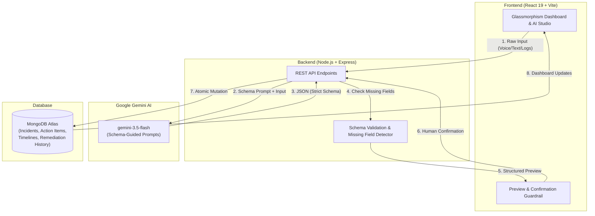

# ⚡ HelioOps — AI Operations & Incident Command

> **Option 10 — AI Operations & Incident Command Platform**  
> An enterprise-grade Incident Command and SRE Automation system powered by schema-guided Generative AI (Google Gemini) and MongoDB Atlas.

[](#-technology-stack)
[](https://www.mongodb.com/atlas)
[](https://ai.google.dev/)
[](#)

---

## 📑 Table of Contents
- [Project Overview & Objective](#-project-overview--objective)
- [Problem Statement](#-problem-statement)
- [System Architecture & Workflow](#-system-architecture--workflow)
- [Core Features & Automation Capabilities](#-core-features--automation-capabilities)
- [Technology Stack](#-technology-stack)
- [Database Design & Schemas](#-database-design--schemas)
- [Schema-Guided Prompt Engineering](#-schema-guided-prompt-engineering)
- [API Endpoints](#-api-endpoints)
- [Safeguards & Edge-Case Testing](#-safeguards--edge-case-testing)
- [Local Setup & Running Instructions](#-local-setup--running-instructions)
- [Limitations & Future Enhancements](#-limitations--future-enhancements)

---

## 🎯 Project Overview & Objective

During high-severity IT outages and DevOps incidents, engineers communicate across fragmented channels: Slack chats, raw log dumps, and frantic voice transcripts. Critical details get buried, action items are lost in post-mortems, and status updates are manual and error-prone.

**HelioOps** automates incident lifecycle operations through schema-guided AI:
1. Translates unstructured incident voice notes and raw descriptions into structured incident records.
2. Extracts post-mortem action items with responsible owners and strict deadlines.
3. Condenses high-volume operational logs into clean, chronological human-readable timelines.
4. Auto-routes incidents to the appropriate on-call engineering teams based on service, severity, and error profile.
5. Updates remediation trackers from natural language and preserves audit histories in MongoDB.

---

## 🚨 Problem Statement

- **Incident Triage Latency**: On-call responders waste critical minutes manually structuring incident tickets during outages.
- **Hallucination Risk**: Unconstrained LLMs frequently fabricate severity levels, timestamps, or system components when information is missing.
- **Unstructured Review Documents**: Action items, owners, and remediation deadlines buried in post-incident documentation lack automated tracking.
- **Audit Deficits**: Status transitions and ad-hoc mitigation actions lack a persistent, timestamped audit trail.

---

## 🏗️ System Architecture & Workflow



---

## ⚡ Core Features & Automation Capabilities

| # | Feature | Input | Output / Behavior | DB Operation |
|---|---------|-------|-------------------|--------------|
| **1** | **Incident Note Parser** | Voice note transcript or natural text | Structured JSON (`title`, `severity`, `impact`, `service`, `error_type`, `missing_fields`) | `Incident.create()` |
| **2** | **Action Item Extractor** | Post-mortem / review document | Action item array (`task`, `owner`, `deadline`, `priority`, `status`) | `ActionItem.insertMany()` |
| **3** | **Log Stream Summarizer** | Raw server log lines / alerts | Chronological timeline events (`event_time`, `event`, `actor`, `event_type`), root cause | `Timeline.insertMany()` |
| **4** | **Smart Incident Router** | Incident attributes | Assigned team (`Platform SRE`, `SecOps`, `DBA`), routing rationale, and escalation path | `Incident.findByIdAndUpdate()` |
| **5** | **Remediation Tracker** | Natural-language status report | Extracted status transition, executive summary, next steps, audit entry | `Remediation.create()` + status update |

---

## 🛠️ Technology Stack

- **Frontend**:
  - React 19 + Vite (Modern, fast HMR build setup)
  - React Router 7 (Single Page Application routing)
  - Custom Cyber-Dark Glassmorphism Design System (CSS Variables, high contrast accessibility, responsive grid)
- **Backend**:
  - Node.js (v18+) & Express.js
  - Mongoose ODM (Object modeling & schema enforcement)
  - CORS, Dotenv, Multer
- **Database**:
  - MongoDB Atlas (Cloud database with replica sets)
  - Schemas: `Incident`, `ActionItem`, `Timeline`, `Remediation`
- **Generative AI**:
  - Google Gemini API (`gemini-3.5-flash`)
  - Strict schema-guided system prompting and zero-shot structured JSON formatting

---

## 🗄️ Database Design & Schemas

### 1. `Incident`
```javascript
{
  title: { type: String, required: true, maxlength: 200 },
  description: String,
  severity: { type: String, required: true, enum: ['P1', 'P2', 'P3', 'P4'] },
  impact: String,
  status: { type: String, enum: ['open', 'investigating', 'mitigated', 'resolved'], default: 'open' },
  service: String,
  error_type: { type: String, enum: ['infrastructure', 'application', 'security', 'performance', 'data', 'unknown'] },
  assigned_team: String,
  assigned_team_reason: String,
  raw_input: String,
  missing_fields: [String],
  createdAt: Date,
  updatedAt: Date
}
```

### 2. `ActionItem`
```javascript
{
  incident_id: { type: ObjectId, ref: 'Incident', required: true },
  task: { type: String, required: true },
  owner: String,
  deadline: String,
  priority: { type: String, enum: ['high', 'medium', 'low'], default: 'medium' },
  status: { type: String, enum: ['pending', 'in_progress', 'completed', 'blocked'], default: 'pending' }
}
```

### 3. `Timeline`
```javascript
{
  incident_id: { type: ObjectId, ref: 'Incident', required: true },
  event: { type: String, required: true },
  actor: String,
  event_time: String,
  event_type: { type: String, enum: ['info', 'alert', 'action', 'resolution', 'escalation'] }
}
```

### 4. `Remediation`
```javascript
{
  incident_id: { type: ObjectId, ref: 'Incident', required: true },
  update_text: { type: String, required: true },
  previous_status: String,
  new_status: String,
  changed_by: { type: String, default: 'Unknown' },
  ai_summary: String,
  key_actions: [String],
  next_steps: String,
  createdAt: Date
}
```

---

## 🧠 Schema-Guided Prompt Engineering

To eliminate hallucinations, HelioOps enforces strict JSON contracts and negative constraints in prompts:

### Sample Incident Parsing Prompt
```text
You are an expert incident management AI for HelioOps.
Parse the following incident note and extract structured data.
Return ONLY valid JSON — no markdown, no explanation, no code fences.

SCHEMA:
{
  "title": string (required, concise 5-10 word title, max 100 chars),
  "severity": "P1" | "P2" | "P3" | "P4" (required — P1=critical/outage, P2=major degradation, P3=minor issue, P4=low impact),
  "impact": string (required, describe affected users/systems/revenue),
  "status": "open" | "investigating" | "mitigated" | "resolved",
  "service": string (required, name of affected service),
  "error_type": "infrastructure" | "application" | "security" | "performance" | "data" | "unknown",
  "description": string (full structured description),
  "missing_fields": [] (array of field names that could not be determined)
}

RULES:
- Do NOT invent information not present in the input.
- If a required field cannot be determined, set value to null and add field name to missing_fields.
- Severity P1 = total outage/data loss; P2 = major feature broken; P3 = minor degradation; P4 = cosmetic/low impact.
```

### Sample Output Generated by AI
```json
{
  "title": "Payment Checkout Gateway 503 Outage",
  "severity": "P1",
  "impact": "1,200 checkouts failed in 15 mins, $45,000/hr revenue loss",
  "status": "open",
  "service": "orders-service",
  "error_type": "performance",
  "description": "Production payment checkout gateway returning 503 Service Unavailable errors due to 100% database connection pool exhaustion on the orders-service.",
  "missing_fields": []
}
```

---

## 📡 API Endpoints

| Method | Route | Description |
|--------|-------|-------------|
| `GET` | `/api/health` | Service health status check |
| `GET` | `/api/incidents` | List all incidents with counts of actions, timeline & remediations |
| `GET` | `/api/incidents/:id` | Retrieve single incident with full relations |
| `POST` | `/api/incidents/parse` | Schema-guided AI parsing (preview mode, no DB write) |
| `POST` | `/api/incidents` | Commit confirmed incident into MongoDB |
| `POST` | `/api/incidents/:id/actions` | Extract & save post-mortem action items |
| `POST` | `/api/incidents/:id/summarize` | Summarize raw logs into timeline events & save |
| `POST` | `/api/incidents/:id/route` | Compute recommended team routing & update incident |
| `POST` | `/api/incidents/:id/remediation`| Process natural-language update & append history |
| `DELETE`| `/api/incidents/:id` | Cascade-delete incident and related data |

---

## 🛡️ Safeguards & Edge-Case Testing

### 1. High-Impact Action Confirmation
High-impact database mutations require user review. The frontend presents a structured preview with badge highlights before invoking the database write endpoint.

### 2. Missing-Field & Ambiguous Input Test Case
When presented with ambiguous or incomplete input:
```text
"Something seems wrong on the frontend or network, some customers said they couldn't load their profiles earlier today."
```
- **System Behavior**: AI flags missing attributes: `missing_fields: ["severity", "impact", "service"]`.
- **Validation**: Backend returns `HTTP 422 Unprocessable Entity` when critical fields (`title`, `severity`) cannot be ascertained, preventing bogus records in the database.

---

## 💻 Local Setup & Running Instructions

### 1. Clone the Repository
```bash
git clone https://github.com/Saikarthik19/heliops_genai.git
cd heliops_genai
```

### 2. Configure Backend
```bash
cd backend
npm install
cp .env.example .env
```
Edit `backend/.env` with your credentials:
```env
GEMINI_API_KEY=your_actual_gemini_api_key
MONGODB_URI=mongodb+srv://<username>:<password>@cluster0.your_cluster.mongodb.net/heliops?retryWrites=true&w=majority
PORT=5000
```
Start the backend server:
```bash
npm start
```
*Backend runs on `http://localhost:5000`*

### 3. Configure Frontend
Open a second terminal:
```bash
cd frontend
npm install
npm run dev
```
*Frontend opens at `http://localhost:5173`*

---

## ⚠️ Limitations & Future Enhancements

- **Real-Time Audio Streaming**: Currently ingests transcribed voice notes; future iterations will include real-time WebRTC audio recording and live streaming transcription via Gemini Multimodal Live API.
- **Bi-directional Slack / PagerDuty Integrations**: Direct webhooks to sync incidents with PagerDuty schedules and Slack incident war-rooms.
- **Vector Search for Historical Outages**: Integrating MongoDB Atlas Vector Search to retrieve similar past incidents and their respective root-cause resolutions.
